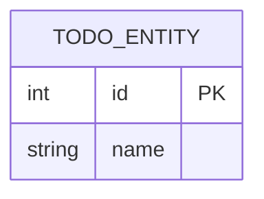

# API и база данных

Документ для ЛР4. Полная схема API — в [docs/api/openapi.json](api/openapi.json): её
выгружает `uv run python scripts/export_openapi.py`.

## Модель данных

ER-диаграмма: не меньше 3 сущностей с атрибутами и 2 связей. Синтаксис связей Mermaid:
`USER ||--o{ BOOKING : makes` (один ко многим), `}o--o{` (многие ко многим).

TODO: пояснение.

## Нормализация

TODO: почему таблицы в 3НФ (атомарные значения, нет частичных и транзитивных зависимостей).
Где сознательно денормализовали и зачем.

## Индексы и ограничения

TODO: какие индексы, UNIQUE, CHECK и внешние ключи есть и под какие запросы.

## Миграции

| Ревизия | Что делает | Как откатывается |
|---------|------------|------------------|
| 0001 | TODO | TODO |

## Эндпоинты

| Метод | Путь | Что делает | Коды ответов |
|-------|------|------------|--------------|
| GET | /health | Проверка живости | 200 |
| TODO | TODO | TODO | TODO |

## Ошибки

TODO: формат RFC 9457 (application/problem+json), какие `type` у вас есть и когда какие
коды (400, 404, 409, 422).

## Пагинация

TODO: offset или курсор, параметры, формат ответа, почему выбрали этот вариант.
