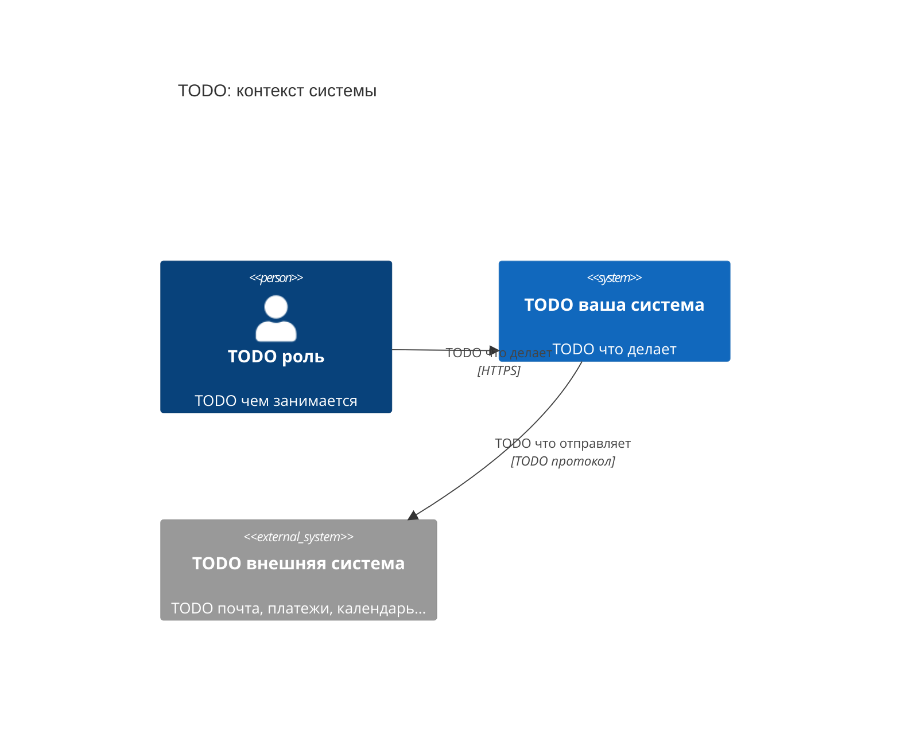
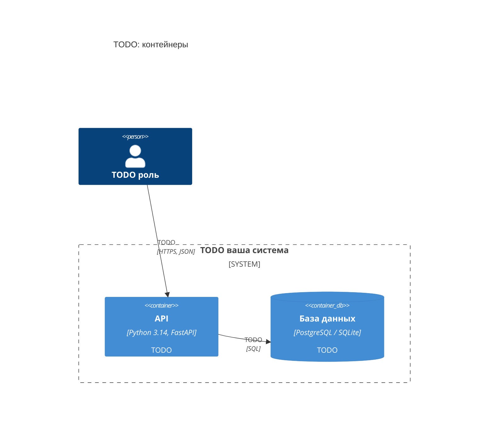
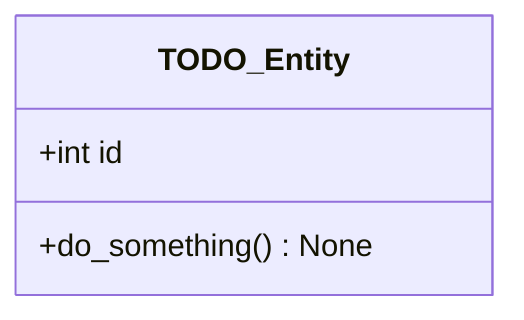
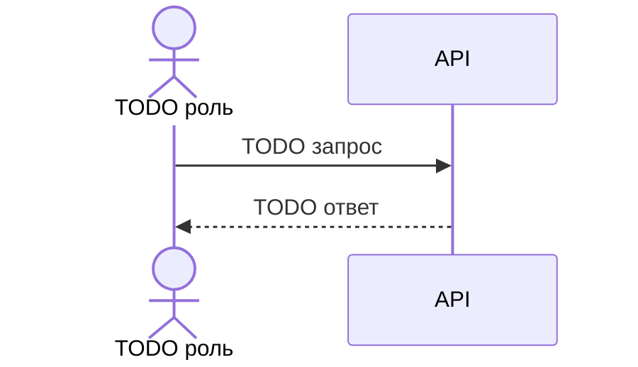

# Архитектура

Документ для ЛР1. Все диаграммы — в блоках ```` ```mermaid ````: GitHub рисует их прямо в
браузере, а автопроверка читает тип диаграммы по первой строке. Проверить синтаксис можно
в редакторе https://mermaid.live. Под каждой диаграммой — два-три предложения: что на ней
показано и почему так.

## Контекст системы (C4, уровень 1)

Кто пользуется системой и с какими внешними системами она связана.



TODO: пояснение.

## Контейнеры (C4, уровень 2)

Из каких запускаемых частей состоит система: приложения, базы, очереди.



TODO: пояснение.

## Диаграмма классов предметной области

Не меньше 5 классов и 4 связей. Показывайте мощности (`"1" --> "*"`), композицию (`*--`),
агрегацию (`o--`), наследование или реализацию интерфейса (`<|--`, `<|..`).



TODO: пояснение.

## Диаграмма последовательности ключевого сценария

Не меньше 3 участников, 4 сообщений и одного фрагмента `alt`, `opt` или `loop`.



TODO: пояснение.

## Архитектурный стиль

TODO: монолит, модульный монолит или микросервисы; слои (домен, сервисы, адаптеры, API).
Почему так, что получаем и чем платим. Подробное обоснование — в ADR.

## Решения

Список ADR из [docs/adr/](adr/):

- TODO [0001 — …](adr/0001-....md)
